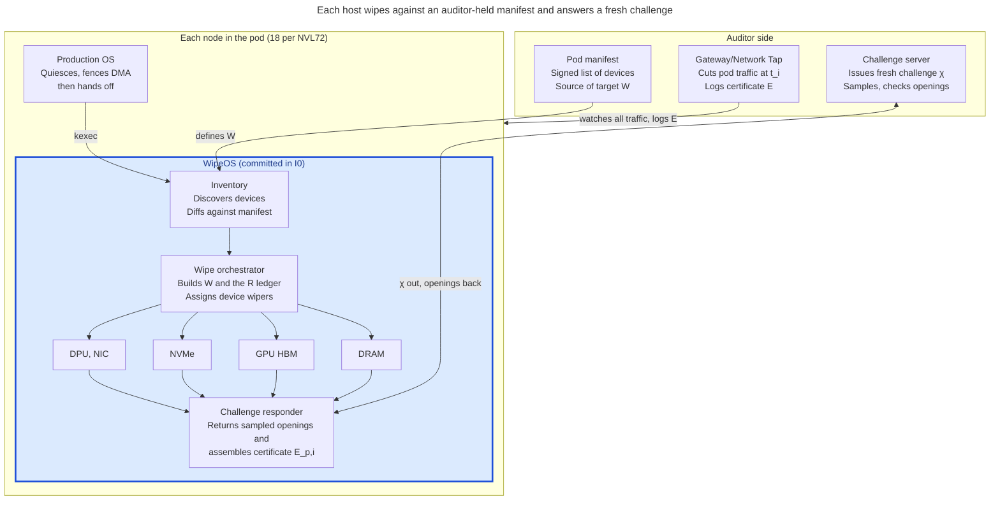

# WipeOS: Design

The architecture and design of WipeOS: what it is for, what it assumes, how an erasure event runs, and the environment it is tested in. Decisions are referenced by number (D1, D2, ...) and recorded in full, with their reasoning, in `docs/decisions.md`. This week's work is in `docs/okrs.md`.

**This file changes only when an accepted decision changes the design.** Claude Code proposes edits here and waits for my approval before making them.

*This repo is the source of truth for the design as of Oct 20, 2026; the Claude Doc "WipeOS: Design Notes and Decision Log" is retired.*

## Purpose and scope

WipeOS is a minimal erasure environment that runs on every host in a pod during a Pod-PoComp erasure event. On each host it overwrites the agreed erasure target W with challenge-dependent data and answers the auditor's challenge, so that at most R bits of uncommitted state survive the wipe. It builds on Amodo's PoSE memory-wiping work.

**Target pod.** The target is an NVL72 rack of 18 compute trays. Each tray is one node running one WipeOS instance, so a pod has 18 nodes, 36 CPUs and 72 GPUs. The paper models an older layout of 36 hosts; this doc uses the tray spec below.

| Per compute tray | Configuration | Function |
| --- | --- | --- |
| Compute | 2 Vera CPUs, 4 Rubin GPUs | Compute node |
| ConnectX-9 I/O cards | 2 | InfiniBand cluster interconnect and multi-rack clustering (east-west) |
| BlueField-4 DPU | 1 | Ethernet storage and system management network |
| Host BMC | 1, RJ45 | Out-of-band management network |
| E1.S NVMe cache drives | 4 | Data cache |
| E1.S NVMe boot drive | 1 | Boot drive |

The memory classes in scope are host DRAM, GPU HBM, the cache and boot drives, DPU and NIC memory, and device caches and queues.

**Why speed and footprint matter.**

- In Pod-PoComp, the allowed compartment input X and output Y scale with the interval between wipes, T_erase. A daily wipe on an NVL72 implies X ≈ 5 GB and Y ≈ 1 GB. Faster wipes allow more frequent wipes, and more frequent wipes tighten both bounds.
- Every byte WipeOS itself occupies, including its kernel, drivers and recovery state, counts toward R unless it is fixed by the commitment I0.
- Reference timings cited in the paper from Amodo: about 8.6 min to fill 190 GiB of HBM, 6.7 min for 490 GiB of DRAM, and about 5 h for 15.36 TB of disk. The paper estimates a volatile-memory erasure event at about 30 min including reboot.

**Out of scope.** The gateway design, the zero-knowledge proof, and Task-PoComp. WipeOS only has to produce what those parts consume: a valid erasure certificate E_p,i and an honest residual bound R_p,i.

Source: Reuter, Marks et al., *Verifiable constraints on frontier training via proofs of compartmentalization* (TAIGR @ ICML 2026), §4.1, §5 and Appendix C.

## Threat model and assumptions

We assume a global inference-only training pause in which both the US and China participate. In that setting hardware attestation reports are not trusted, and some hardware cannot produce them at all.

**Consequences for WipeOS.**

- The paper allows firmware and recovery state to be "attested as fixed". We cannot use that option. Any mutable state must either be overwritten and checked, or charged to R.
- What the host reports about its own hardware is untrusted. The erasure target has to come from an auditor-held configuration, not from the pod describing itself (see System inventory).
- WipeOS itself has to be committed in I0 and kept small, because its resident footprint is charged to R.

**Auditor-side infrastructure (assumed in place).** The whole design assumes the datacenter already has auditor-run network taps installed. WipeOS depends on this infrastructure but does not build it. The auditor side must:

- read all pod ingress and egress on the north-south network. The paper's gateways are these taps.
- have the capacity to host the challenge server for every pod's erasure events, with enough compute to query all 18 nodes of a pod simultaneously (for example, around 32 cores).
- alert auditors to any failed challenge.

Without installed taps, Pod-PoComp has nothing to anchor to, and this design does not apply.

**Physical isolation (assumed in place).** East-west networking is removed from the pod: the ConnectX-9 InfiniBand cluster links used for multi-rack clustering are unplugged, and physical security verifies they stay unplugged. NVLink inside the rack stays, since it never leaves the pod. Every remaining external link must pass through the Gateway/Network Tap, so the only traffic in or out of the pod is monitored. A pod is a single NVL72 rack; pods spanning several racks are out of scope for now.

**Assumptions taken from the paper.**

- Gateways are auditor-trusted, and unrecorded traffic per pod is at most B bits over the monitoring period.
- The fill is challenge-dependent. It is either streamed from the challenge server or produced by a memory-hard generator, so the pod cannot answer by recomputing it while hiding old state elsewhere.
- The response window is short enough that missing data cannot be fetched or regenerated after the challenge indices are revealed.
- During the erasure window the gateway blocks or records all traffic, so state cannot be parked on another pod and restored afterwards.

## Architecture overview

The proposed architecture splits the work between the auditor side and each pod host. The auditor's manifest fixes what gets wiped, and the challenge server checks that it was. WipeOS on each host discovers its devices, runs the device wipers in parallel, and returns the certificate.

Everything inside the WipeOS box, including its own footprint, is either committed in I0 or charged to R. Cross-node coordination follows the barrier protocol in D8.

## Erasure event phases

An erasure event runs ten phases across all 18 nodes of the pod. The challenge server waits for every node at two barriers (D8), and a node that misses a barrier fails the event (D9).

1. **Cut-off.** The Gateway/Network Tap stops ordinary pod traffic, leaving only the erasure channel to the challenge server, and records the cut-off time.
2. **Image delivery and handoff.** The challenge server sends each node's agent the trigger message (D19). The agent downloads the WipeOS image over the erasure channel, checks its hash against I0, and stages it with kexec -l. The production OS then stops workloads, tears down GPU contexts, drains device queues, and fences DMA paths not needed for erasure, and jumps into WipeOS with kexec -e (D2).
3. **Inventory pre-check.** WipeOS discovers the node's hardware and diffs it against the auditor manifest (D4). The output is the node's target W and residual ledger. A mismatch aborts the event.
4. **READY (barrier 1).** Each node reports READY, and the challenge server waits for all 18.
5. **SEED.** The challenge server broadcasts a fresh challenge χ to every node at once. χ is the start signal, because the fill depends on it.
6. **Fill.** Each node overwrites every region in its W with χ-dependent labels (D5), all devices in parallel. Caches and queues that can be flushed are; the rest is charged to R.
7. **FILLED (barrier 2).** Each node reports FILLED, and the challenge server waits for all 18. The slowest device, usually NVMe, sets the pace.
8. **QUERY and RESPONSE.** The challenge server sends sampled indices covering every memory class to all nodes simultaneously. Each node returns small openings, about 64 B each, within the deadline.
9. **VERDICT and certificate.** The challenge server checks the openings and decides whether the pod passed. Each node's certificate E_p,i binds the node, t_i, χ, W_p,i, the response time, the coverage and R_p,i, and the Gateway/Network Tap records it. A failure alerts the auditors.
10. **RELEASE.** The challenge server tells WipeOS to shut down, and each node boots its host OS through a clean path. Anything loaded that is not committed in I0 is charged as next-interval ingress.

Paper budget for an NVL72 (about 13 TB HBM and 17 TB DRAM): tens of minutes for phases 3 and 4, and about 30 min end to end. Local NVMe at the paper's 15.36 TB per host would take hours.

## System inventory: how WipeOS learns the pod layout

The proposed approach (D4) uses two sources: an auditor-held pod manifest that defines what must be wiped, and live discovery inside WipeOS that checks the hardware matches it. Both produce the same schema, so they can be compared field by field.

**Flow.**

1. **Manifest.** The auditor and developer agree a versioned, signed manifest per pod. It lists the host count, the NVLink domain membership, and per host every device with its capacity and wipe method.
2. **Discovery.** In phase 0, WipeOS enumerates the hardware from the sources in the table below and emits a discovered manifest in the same schema.
3. **Diff.** Any device missing, any undeclared device, or any capacity below what was declared aborts the event. The diff result goes into the certificate.
4. **Target and ledger.** The accepted manifest expands into W_p,i, the regions each wiper must cover, and a residual ledger listing everything charged to R_p,i, with sizes.

**Dev mode.** For test configurations, discovery alone generates a draft manifest and the wipe launches from it. This is the "poll the system, then launch the wipe" path for profiling and debugging on varied hardware.

**Limit.** Discovery runs on an untrusted host. It catches configuration drift and honest errors, but not a host that lies. What binds capacity is the timed challenge over a W taken from the auditor's manifest, which a host cannot shrink. Hidden memory the auditor never declared is a physical-inspection problem.

| Component | Manifest declares | Live discovery source (candidate) | Residual notes |
| --- | --- | --- | --- |
| Host DRAM | Capacity and ranges per host | UEFI memory map, /proc/iomem, ACPI SRAT | Firmware-reserved ranges and the WipeOS footprint go in the ledger |
| GPU HBM | GPU count and HBM per GPU | PCI enumeration, then NVML memory queries | Driver-reserved HBM that cannot be allocated for fill goes in the ledger |
| Local NVMe (cache and boot) | Drive count and raw capacity per drive (4 cache drives and 1 boot drive per tray) | NVMe Identify Controller (TNVMCAP, UNVMCAP) and Identify Namespace | Over-provisioned NAND is not addressable. It is charged to R, or the drive leaves the pod |
| NICs and DPUs | Model and on-board memory | PCI enumeration; a BlueField-4 runs its own OS and needs its own agent | Firmware and DPU-side state, per D1 |
| NVLink and network topology | Which hosts share the NVLink domain; NIC ports | NVML NVLink queries, fabric state | Determines which cross-host paths must be fenced and how fill streams are assigned |

## Software stack

Nothing here is decided yet. These are the layers WipeOS needs and the leading candidate for each, to be settled as decision rows.

| Layer | Candidate | Why it is a question |
| --- | --- | --- |
| Kernel | Minimal Linux config with only the drivers the pod manifest needs | Every built-in driver adds to the footprint charged to R |
| Entry | kexec from the production OS (D2), with the image served by the challenge server (D19) | Need to confirm what state the handoff leaves behind on Vera hosts |
| Userspace | Single static binary in an initramfs, holding the wipe agent | Smaller and easier to itemize than a general userspace |
| GPU access | NVIDIA kernel driver plus a minimal CUDA path for the HBM fill and label kernel | Required to write HBM at speed, but it is the largest single footprint item |
| Storage | Direct NVMe I/O at full queue depth | Disk wipe is the time bottleneck; this is where label-generation speed matters |
| Network | Minimal stack to the challenge server only | Everything else is fenced during the event |

## Test environment

Benchmarking runs on Lucid's DGX H100 node, h100-sxm-8-0, wiping a subset of its GPUs rather than the whole node (D10). The cluster also has a network tap, which can stand in for the Gateway/Network Tap.

|  | DGX H100 node | H100 NVL node |
| --- | --- | --- |
| Name in cluster | h100-sxm-8-0 | h100-nvl-1-0-cc |
| Rack | Rack One | Rack Two |
| GPUs | 8 × H100 80 GB HBM3 | 1 × H100 NVL 94 GB |
| GPU memory | 640 GB | 94 GB |
| GPU interconnect | NVLink / NVSwitch | none |
| CPU | 2 × Xeon Platinum 8480CL, 112 cores / 224 threads | 2 × Xeon Gold 6544Y, 32 cores / 64 threads |
| Memory | 2 TiB | 768 GB |
| Local NVMe | 34 TB raw | 3.8 TB raw |
| Confidential computing | Not available | Enabled |

The H100 NVL node is out of scope for now. The challenge server runs on one of the cluster's CPU-only servers, where the network tap is currently emulated (D13).

**Test ladder (D12).**

1. Local wiping: WipeOS launched directly on the node, with no host-OS handoff. This starts in Linux emulation on a laptop.
2. Auditor emulation: the tap and the DGX node together play the auditor and the host.
3. Multi-node: the DGX node split into two nodes to test the D8 barrier protocol.

**Benchmark scale-up (D11).**

1. Individual components: chunks of DRAM, GPU memory and NVMe, starting with one reserved GPU and a dedicated NVMe allocation.
2. Simultaneous: whole GPUs plus chunks of DRAM and disk at once.
3. Full node: all DRAM and GPU memory in an overnight reservation, and a full-node wipe if the cluster managers approve.

**Tiered test plan.** Seven tiers combine the test ladder and the scale-up. The amounts are proposed starting points. Each tier must pass before the next starts, and cluster approvals are requested tier by tier later, not before the OKRs.

| Tier | Where | What is wiped | Challenge server | What it proves | Needs from the cluster |
| --- | --- | --- | --- | --- | --- |
| T0 | x86_64 VM, on the laptop under emulation or on a cluster CPU-only server | 1 GB of guest DRAM | None; local self-check | WipeOS boots, discovers memory, fills and reads back | Nothing, or a CPU-only server |
| T1 | DGX node; WipeOS launched directly, no kexec handoff | 16 GB DRAM; 8 GB HBM on 1 GPU | None; local self-check | DRAM and HBM wipers work on real hardware | 1 GPU reservation |
| T2 | DGX node | 64 GB DRAM; all 80 GB HBM on 1 GPU; 100 GB NVMe | None; local self-check | NVMe wiper and a whole-GPU fill | 1 GPU; dedicated NVMe allocation |
| T3 | DGX node plus the CPU-only server, through the tap | Same as T2 | Yes | The single-node SEED, FILLED, QUERY, RESPONSE and VERDICT flow through the tap | Tap and CPU-only server access |
| T4 | DGX node plus the challenge server | 512 GB DRAM; 4 GPUs (320 GB HBM); 1 TB NVMe, all at once | Yes | Parallel wipers and simultaneous queries | 4 GPUs; larger NVMe allocation |
| T5 | DGX node split into two logical nodes of 4 GPUs each, plus the challenge server | Same as T4, split across the two nodes | Yes | D8 barriers and D9 timeouts across nodes | Same as T4 |
| T6 | Whole DGX node, overnight, with kexec handoff from the production OS | All 2 TiB DRAM and 8 GPUs (640 GB HBM); NVMe within the allocation, or all 34 TB if approved | Yes | A full-node event end to end, including handoff and RELEASE | Overnight full-node reservation; managers' approval for full NVMe |

## Codebase design

Not started. It will follow the component split in Architecture overview once that settles.
